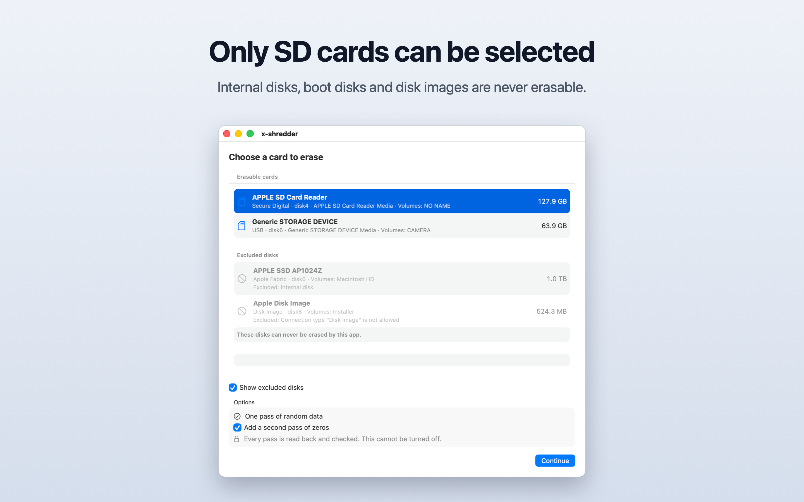
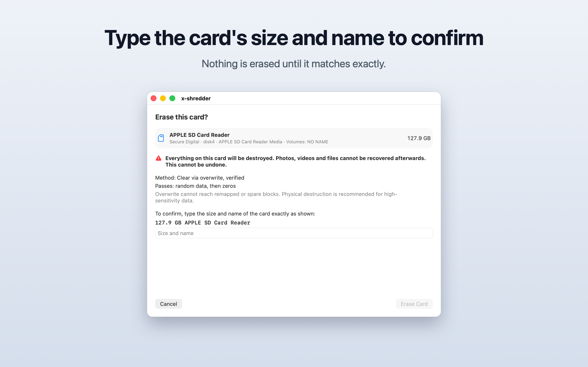
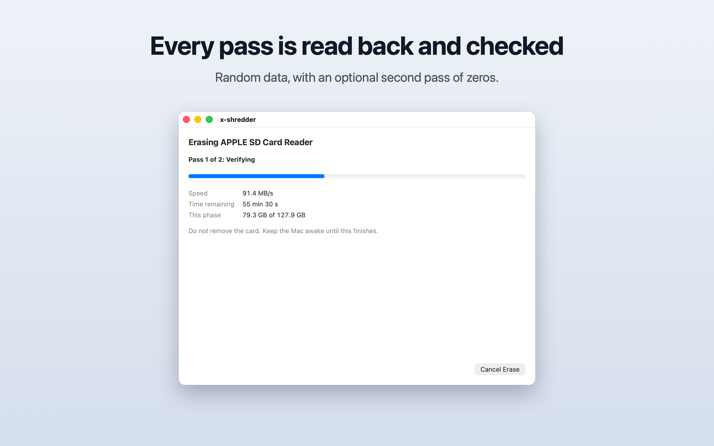
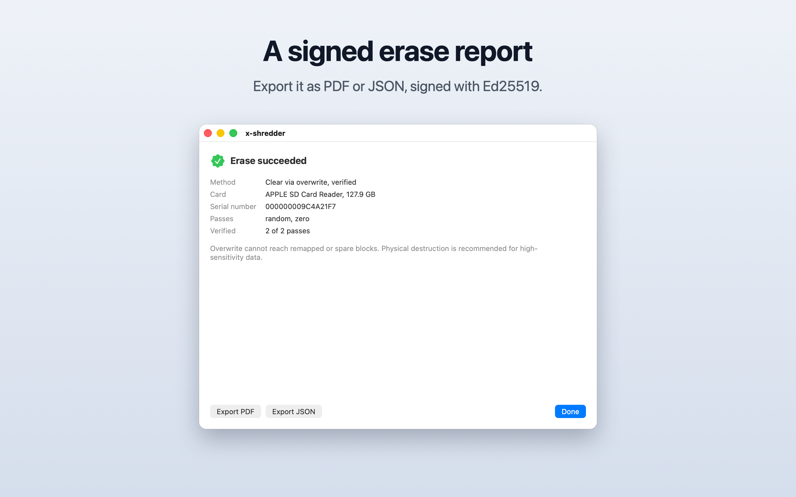

# x-shredder

A macOS app that erases an SD card (in the Mac's built-in SD card slot or a USB card reader) by overwriting all of it and then reading all of it back to check. The method is NIST 800-88 "Clear" via overwrite, and the app reports it as exactly that. It produces a signed erase report.

The app never erases internal disks, boot disks, disk images or network volumes. This is a hard rule, not a setting.

Requires macOS 13 or later on an Apple silicon Mac. Intel Macs are not supported.

## Screenshots

<table>
  <tr>
    <td><picture><source media="(prefers-color-scheme: dark)" srcset="docs/screenshots/1-devices-dark.png"></picture></td>
    <td><picture><source media="(prefers-color-scheme: dark)" srcset="docs/screenshots/2-confirm-dark.png"></picture></td>
  </tr>
  <tr>
    <td><picture><source media="(prefers-color-scheme: dark)" srcset="docs/screenshots/3-erasing-dark.png"></picture></td>
    <td><picture><source media="(prefers-color-scheme: dark)" srcset="docs/screenshots/4-result-dark.png"></picture></td>
  </tr>
</table>

## Do you love this project? Sponsor it!

Your sponsorship pays for x-shredder maintenance and for building new features.

<p align="center">
  <a href="https://github.com/sponsors/pkminhas"></a>
  <a href="https://ko-fi.com/pkminhas"></a>
</p>

## Status

Built and tested locally. 


## How it works

| Component | Runs as | Responsibility |
| --- | --- | --- |
| App (SwiftUI) | Normal user | Device list, options, confirmation, progress, report export |
| Helper (launch daemon) | root | Re-validates the disk, performs the erase, reports progress over XPC |
| Engine (Swift package) | Inside helper | Raw block device, pattern generator, write and verify passes, checkpointing |
| DiskGuard (Swift package) | App and helper | Eligibility rules, the only code that decides if a disk is selectable |
| Report (Swift package) | App | Builds, signs and exports the erase report |

The app never touches a raw device. It sends the helper a BSD name (for example `disk4`) and nothing else.

### Internal-disk protection

Enforced in three independent layers:

1. **Eligibility rules (DiskGuard).** A disk is selectable only if every rule passes: whole disk, not internal (except the built-in SD card slot, see below), not virtual or a disk image, not the boot disk or behind a mounted system container, removable or ejectable, protocol in the allowlist (`USB`, `Secure Digital`), at most 2 TB, writable. Any value that cannot be read counts as a failure.
2. **UI.** Only eligible disks can be selected. Excluded disks can be shown greyed out with the reason. There is no override.
3. **Helper.** Accepts only a BSD name from a caller signed by the same team with the app's bundle ID. It re-runs DiskGuard on fresh data, captures an identity fingerprint, unmounts, opens the device exclusively, checks the fingerprint again, and aborts if the device ever resolves to the boot disk or an internal disk during the erase.

### Built-in SD card slot

macOS reports the built-in SD card slot as an internal device. The "not internal" rule makes one exception for it: a disk passes that rule if it is internal, its protocol is `Secure Digital`, it is not layered or virtual, and it sits directly under Apple's SDXC driver (`AppleSDXCBlockStorageDevice`, `AppleSDXCSlot`, `AppleSDXC`). Every other rule still applies to it, including the boot-disk, removable, size and write-protect rules. The helper's in-flight guard uses the same exception.

### Erase

- Pass 1 writes AES-CTR random data across the whole card and reads it all back. This also detects fake-capacity cards.
- An optional second pass writes zeros and reads them back.
- Verification cannot be turned off.
- Writes are retried 3 times, then the erase fails.
- Progress is checkpointed so an interrupted erase can resume. A cancelled, failed or interrupted run is never reported as a success.

### Report

JSON and PDF, signed with Ed25519. It includes the tool version, date and time, device model, size, serial if available, passes, verification result, errors and the method label. It states the limits of overwrite: remapped and spare blocks cannot be reached, and physical destruction is recommended for high-sensitivity data.

## Repository layout

```
x-shredder/
  x-shredder.xcodeproj
  x-shredder/            App (SwiftUI)
  x-shredder-helper/     Privileged helper
  Shared/                XPC protocol and constants used by app and helper
  HelperSupport/         launchd plist for the helper
  Packages/DiskGuard/    Eligibility rules, fixtures and the diskguard-dump tool
  Packages/Engine/       Erase engine
  Packages/Report/       Erase report
  x-shredderTests/
scripts/                 Test, lint and release-flag scripts
USER-GUIDE.md            Using the app
implementation-plan.md   Design
task-list.md             Task status
```

## Building from source

There are no prebuilt downloads. Build the app yourself.

1. Open `x-shredder/x-shredder.xcodeproj` in Xcode, signed in with your Apple ID (a free personal team works).
2. Under Signing & Capabilities, select your own team for both the `x-shredder` and `x-shredder-helper` targets. The app and the helper must be signed by the same team, or they refuse to talk to each other.
3. Build the Release app:

   ```
   xcodebuild -project x-shredder/x-shredder.xcodeproj -scheme x-shredder \
       -configuration Release -derivedDataPath build build
   ```

4. Move `build/Build/Products/Release/x-shredder.app` to `/Applications`. Do this before installing the helper. The helper is registered at the app's location, so moving the app afterwards breaks the registration.

Debug builds also list small scratch disk images (256 MB or less) as erasable, for testing without a card. This is compiled out of Release builds.

## Setting up the helper

Erasing needs a helper that runs with administrator rights.

1. Open x-shredder and click "Install Helper".
2. Open System Settings → General → Login Items. Under "Allow in the Background", turn on x-shredder.
3. Back in x-shredder, click "Open Full Disk Access". This opens System Settings → Privacy & Security → Full Disk Access and shows `x-shredder-helper` in a Finder window.
4. Drag `x-shredder-helper` from the Finder window into the list, or click + and choose it (it is in `x-shredder.app/Contents/MacOS`). Turn it on.
5. Go back to x-shredder. The notices disappear once the helper is approved and has Full Disk Access.

macOS does not let the helper open the card without Full Disk Access, even though it runs with administrator rights. Without it, erasing fails.

See `USER-GUIDE.md` for erasing a card.

## Removing it

1. In x-shredder, choose "Remove Helper" from the x-shredder menu.
2. Delete `/Applications/x-shredder.app`.
3. Optional: delete `/Library/Application Support/com.withpreet.x-shredder` (needs an administrator). It holds the helper's journal of the last run and the resume checkpoint.

## Testing

```
scripts/test-all.sh
```

Runs the safety lint, the tests for all three packages, the app tests and the release-flag check. Set `XSHREDDER_DISK_IMAGE_TESTS=1` to also run the tests that attach a small scratch disk image.

To print the disk descriptions DiskGuard sees on your Mac (read-only):

```
cd x-shredder/Packages/DiskGuard
swift run diskguard-dump
```

## License

MIT. See `LICENSE`.
